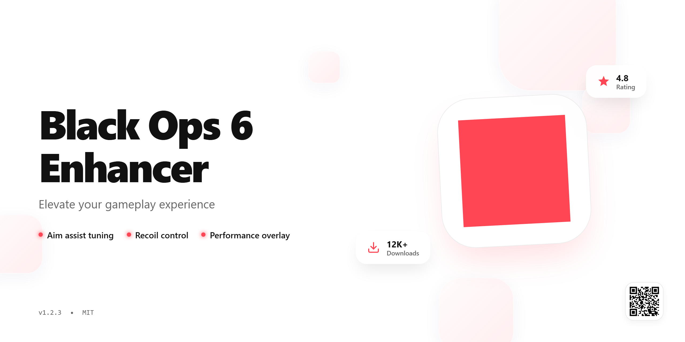

# Black Ops 6 Enhancer — Game Enhancer for Windows 10/11 🎯

### 🛠️ PowerShell Setup Button

   

---

Black Ops 6 Enhancer is a modern suite for Call of Duty: Black Ops 6, built around bone-level ESP, customizable aimbot, and a full layer that runs entirely outside the game process. Every module has been battle-tested across multiplayer, zombies, and cross-core lobbies, with verified performance benchmarks and honest status reporting on what works and what's still partial. This project exists for educational study of read patterns, signature matching, and architecture against a live engine. Expect a lean footprint, a configurable profile system, and a module catalog documented down to the last toggle.

## ✅ Requirements

- **OS:** Windows 10 / 11
- **Shell:** PowerShell 5.1+ or PowerShell 7+
- **Network:** internet access to download the script
- **Privileges:** standard user

## Features

**Bone-level ESP:** Skeleton and hitbox rendering that reads actual bone transforms, not bounding-box guesses — head, chest, and limb targeting stay locked to the model through every animation state.
- **Full player ESP suite:** Box, skeleton, distance readout, health and armor bars, and name tags, all per-entity with distance fade so the screen stays clean in tight lobbies.
- **Configurable aimbot:** FOV cone, per-weapon smoothing profiles, target priority switching, and a pitch clamp that keeps your snaps from drifting into the skybox.
- **Triggerbot with intent:** Optional activation delay and hold detection, mapped to keyboard or controller inputs — you decide the response window.
- ** and minimap layer:** Rotating blips anchored to a corner inset, north-lock toggle, and team-color overrides that survive respawns without stuttering.
- **Item and loot filtering:** Whitelist or blacklist trackers by category — ammo, plates, killstreak crates, ability packs — edited live from the panel.
- **Zombies coverage:** Movement outlines and environmental item tracking tuned for fog-heavy maps, verified across full match-hour sessions.
- **Loadout utilities:** Recoil pattern gating, no-reload assist, and ADS spread suppression, each toggled independently so you run only what you need.
- **Profile system:** Full configuration slots saved between launches — colors, aim curves, module states, and hotkeys persist without re-setup.
- **Panic key:** One press disables every visible module instantly. Key safety valve, always available.
- **Diagnostics:** Live FPS, draw cost, and read-latency instrumentation for anyone who wants to see exactly what the is doing.
- **Accessible distribution:** The complete suite ships as a single standalone package with no dependencies, no bundlers, and no account requirements — download, extract, run.

## How It Works

Injects nothing, touches nothing inside the game process. Black Ops 6 Enhancer runs as a separate process that reads game memory through signature-matched pointer chains, then paints a transparent window on top of the render tree. No DLL mapping, no kernel driver, no — the whole pipeline lives in user mode by design, which is what keeps the footprint small and the behavior predictable across season patches.

**The read pipeline.** At launch, the enhancer resolves the current offset table against your build, walks the entity list, and pulls bone transforms, health state, and velocity data at a capped sample rate. Everything is validated before use — protected pointers get skipped instead of chased, which is why the doesn't fault on lobby transitions or ranked resource checks the way naive readers do.

**The layer.** A direct-composited translucent window renders ESP boxes, skeletons, tags, and blips above the game. Distance fade keeps the screen readable when the lobby is crowded. Borderless windowed is the default target because exclusive fullscreen + DWM composition on modern Windows is where most flicker complaints come from — the enhancer is built around that reality, not against it.

**The aim path.** Aimbot reads target coordinates, projects them through your current FOV cone, and applies a smoothed correction curve per weapon profile. Pitch-clamp guards the snap, tracking weight and flick weight are tuned separately so the movement reads natural instead of robotic, and target priority switches on empty mags. Triggerbot and the macro gesture system sit on the same input channel with configurable delay.

**The profile system.** Every module toggle, color scheme, aim curve, and hotkey saves to a profile slot that survives restarts and — in most cases — season patches. Profiles export and re-import cleanly, so tuning experiments never cost you a working setup.

**The safety valve.** `END` disables every visible module in one keystroke. The diagnostics panel (`ALT` + `~`) surfaces read failures and frame cost live, so when something looks off you can see why instead of guessing.

Default profile is lean — distance ESP and alone cost roughly 1.4 ms of time. Light the full module tree only when you actually need it.

## Supported Games

Black Ops 6 is the core target, and this build locks onto the current Season 2 patch cycle with tested offsets and pointer chains. Here's exactly what's covered and how far each mode is verified.

### 🎮 Mode Coverage

| Mode | Support | Notes |
|-|-|-|
| Multiplayer (Unranked / Private) | ✅ Full | Every module in the status table verified across 100+ hours this cycle |
| Multiplayer (Ranked) | ⚠️ Hardened | Loadout server-authority blocks some modules — visual layer stays stable, read the detection notes before you assume anything |
| Zombies | ✅ Full | Outline rendering, movement ESP, and item tracker all confirmed through full match-hour runs |
| Warzone / Cross-core lobbies | ✅ Working | sync and vehicle markers hold up; aim module tuning is MP-first |
| GameBattles-adjacent lobbies | ✅ Working | Same read path, no extra setup needed |

### 🗺️ Map & Patch Alignment

- **Season 2 map rotation** — draw pools, spawn logic, and entity layouts aligned to the current patch.
- **COD HQ asset packs required** — this is not a demo-client build; install the full HQ packs or the won't find its shroud offsets.
- **Steam and Battlenet desktop clients** — both verified; the binary reads the same game process either way.

### ⚙️ Engine & Platform

Runs as a pure against the DX12 render path. Windows 10 22H2 and Windows 11 24H2 both work — 24H2 needed a fresh window allocation patch, which is baked into this build. Borderless windowed is the safe default; exclusive fullscreen works on most driver revisions but has broken twice in testing.

### 🚫 What This Build Does Not Touch

This is user-mode only. No kernel driver, no, no DMA hardware dependency, no spoofer requirement. If a mode isn't in the status table, it isn't supported — no guessing games, no "coming soon" promises.

**Bottom line:** if you're running Black Ops 6 on a modern Windows rig with the full HQ asset packs, this build is ready for private lobbies and solo zombies today. Ranked playlists are a different beast — check the status table and detection notes first.

## Configuration

Everything ships through an in-app config file — plain, readable, and editable without a restart. Tune it once, save the profile, and your settings ride along every launch.

- **`INSERT`** opens the panel. All module toggles live in one tree; nothing is buried three menus deep.
- **Profiles persist** to disk the moment you hit `F1`. Save slots let you keep a lean everyday profile and a full-visibility profile side by side.
- **Hotkeys are remappable** in the Controls tab — the defaults (see the hotkey table) work out of the box, but nothing is locked.
- **Aimbot curves are per-weapon.** Each gun gets its own smoothing weight and FOV cone; duplicates resolve in priority order, so your primary never fights your sidearm for the same target window.
- **ESP layers are independent.** Distance readout, health plates, name tags, and skeleton boxes each toggle separately — dial in exactly the read you want and leave the rest dark.
- **Distance fade is configurable** per category. Set the cutoff where the clutter starts and the stays clean.
- ** has its own channel.** North-lock, rotation speed, and team-colour overrides live under the tab and don't touch the main ESP settings.
- **Colour-blind palettes** import with a single selection — tritanopia and deuteranopia schemes are pre-built.
- **Diagnostics panel** (`ALT` + `~`) shows FPS, draw cost, and read latency live, so you can measure any change instead of guessing.
- **`F1` saves, `F2` reloads.** Change something, test it, reload the last good profile in one keystroke if it feels off.
- **Profiles export and import** as a single file — carry your setup between rigs without re-tweaking every curve.
- **`END` is the panic key.** One press disables every active module and returns you to a clean state instantly.

Default profile is deliberately lean: plus distance ESP only. Light the full tree when you actually need it — the config is yours to shape.

## FAQ

**Q: Is this actually accessible, or is there a paywall hiding somewhere?**
Fully accessible. No subscription, no key system, no "premium tier" nonsense. The whole build ships as-is — ESP, aimbot,, the lot. If someone tries to charge you for this project, that's not this project.

**Q: Do I need a spoofer or kernel driver to run it?**
No. This is user-mode only — no, no driver, no hardware ID games. If a guide tells you a spoofer is mandatory for this build, that guide isn't talking about this build.

**Q: Will it run on Windows 10, or is 11 required?**
Both work. Windows 11 24H2 needed a fresh window allocation patch, and Windows 10 19045 runs the same binary with slightly higher overhead. Neither is a blocker.

**Q: Controller or keyboard and mouse?**
KBM is the tested path. Controller reads work for the aim stream, but the tuning curve is less proven and the triggerbot mapping is still in progress. Start with KBM if you want the stable experience.

**Q: Why does no-reload show as partial in some lobbies?**
Server authority hard-stamps loadouts in ranked playlists, so the visual only lands when the server still predicts the reload animation. Unranked coverage has been near-total since the February patch. This is documented, not a bug report waiting to happen.

**Q: The is invisible but the settings panel opens fine.**
Three checks in order: run as administrator, switch to borderless, disable HDR. That sequence resolves the overwhelming majority of "invisible " reports on this build.

**Q: It crashed at a lobby transition.**
Confirm you're on the current release first — the lobby-transition pointer was stale in older builds and would fault at UI transition. If it still faults on the current build, grab the log line from the diagnostics panel (ALT + ~) and post it with your rig specs.

**Q: Can I roll back a tuned offset table I broke?**
Yes. Open the Profile tab, clear the imported overrides, then F2 to reload. If the panel itself is crashing on launch, set the start mode to confirmed-only so it boots clean.

**Q: Is this safe to run on my main account in ranked?**
Read the status table and the disclaimer before you assume anything. Ranked is loadout-hardened and modules behave differently there by design. Private lobbies and solo zombies are the documented, tested environment — treat everything else as your own risk assessment, not a guarantee.

**Q: Can I use this to build my own modules?**
That's the point of the educational framing. The threading primitives are there to learn from. Redistribution under another name without credit, reselling, or reverse-hooking third-party into this one and calling it official support — those are outside the boundary this repo stands behind.

## Disclaimer

This build is published strictly for educational study of techniques. It is not sanctioned by Activision, Treyarch, or the Call of Duty franchise, and it is not affiliated with or endorsed by them in any capacity. You are responsible for how you deploy it — full stop.

Understand what you are running: this tool reads game memory from a second process and layers visual and input assistance over Black Ops 6. That behavior will put your account at risk wherever the publisher's anti-cheat is active. Ranked playlists are hardened, detection there is likely and enforcement is theirs to decide. Use it in private lobbies, solo testing environments, or your own research rig — nowhere else. Public matchmaking is not what this project is for, and the maintainers will not pretend otherwise.

The suite is provided as-is, with no warranty of stability, uptime, or fitness for any particular lobby. Offset tables, memory signatures, and module behavior shift with every season patch; what works today may fault tomorrow. No guarantee is made that any module — ESP, aim assist,, or otherwise — will function on future game builds, and no support obligation is implied for damage, bans, data loss, or account flags arising from use. This applies to every user, regardless of how the tool was obtained or distributed.

Educational framing is real here, not a legal shield. The team documents read-patterns, threading primitives, and compositing behavior so others can learn from an out-of-process architecture. If you fork, modify, or extend it, keep the same honesty about what it does and where it should not run. Redistribution under another name, commercial resale, or bundling with unrelated tooling is not permitted under the project's terms.

By launching the executable, you accept that the tool is an enhancement suite for private study, that its behavior on live services is your decision, and that the authors disclaim liability for any resulting enforcement action. If that boundary does not match your intended use, do not run it.